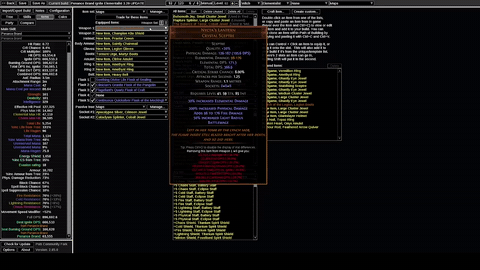
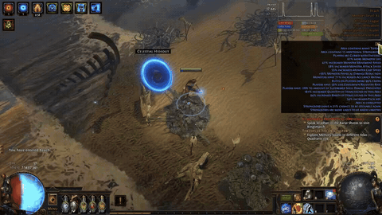
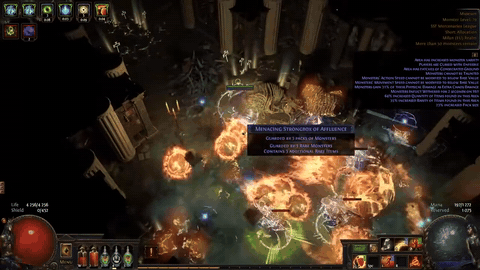
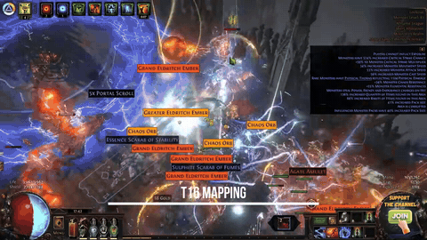
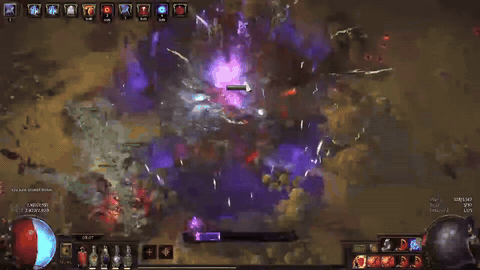
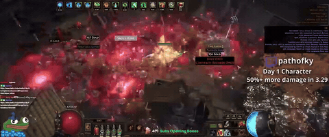
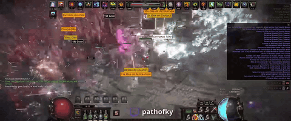
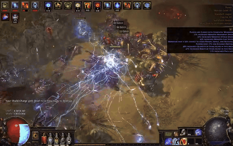
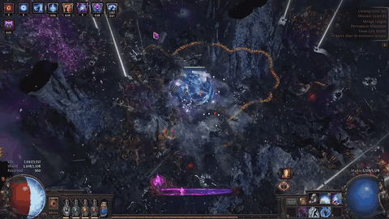

# What each ranked build looks like while mapping

8-second clips cut from creators' build videos, in the order of the [ranked list](wand-and-spell-shortlist.md#top-picks). Footage is from 3.29 (Volatile Dead from 3.26), so it shows the playstyle, not 3.30 numbers. Each heading links to the exact spot in the source video if you want to keep watching.

To move or add a clip: edit `tools/mapping_clips.json` and run `python tools/yt_gif.py <slug> --force` on the PC (YouTube is blocked from Claude's cloud sessions).

## 1. Penance Brand Ignite Elementalist

Goratha 3.29, 'Mapping and clearing' chapter (gameplay starts ~3:32; 2:50-3:30 is PoB) · [watch from 3:44](https://www.youtube.com/watch?v=42t9yK-9_Go&t=224s)

## 2=. Winter Orb Occultist

SoloHood 3.29, T16 8-mod map · [watch from 6:50](https://www.youtube.com/watch?v=zYLg8-yYkoY&t=410s)

## 2=. Volatile Dead Spellslinger Elementalist

Tuadh 3.26 league-start run, red maps · [watch from 7:31:40](https://www.youtube.com/watch?v=VJyzmqdrETg&t=27100s)

## 2=. Kinetic Bolt Elementalist

K2Gaming 3.29, T16 8-mod map · [watch from 0:12](https://www.youtube.com/watch?v=TrkI-sZYshU&t=12s)

## 5. Kinetic Blast of Clustering Necromancer

Legi1 3.29, map showcase · [watch from 6:05](https://www.youtube.com/watch?v=lRjDLu8c6Dw&t=365s)

## 6. Bladefall + Blade Blast Assassin (Spellslinger)

Ky 3.29, Spellslinger map showcase (10:38 is a loading screen) · [watch from 10:48](https://www.youtube.com/watch?v=d3fCmCBM0F0&t=648s)

## 6. Bladefall + Blade Blast Assassin (cast on crit)

Ky 3.29, cast-on-crit map showcase (12:19 is a loading screen) · [watch from 12:27](https://www.youtube.com/watch?v=VPZCB0Edl9k&t=747s)

## 6. Lightning Tendrils / Lightning Conduit Elementalist

Peuget2 3.30 Tendrils starter, endgame map · [watch from 0:53](https://www.youtube.com/watch?v=sOKiVtyhb8M&t=53s)

## 8. Spark of the Nova Archmage Hierophant

Big Ducks 3.29, intro gameplay · [watch from 0:20](https://www.youtube.com/watch?v=DpHXNVNeH88&t=20s)
