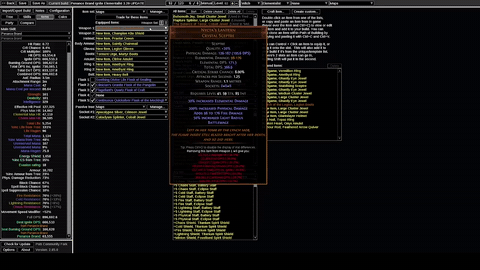
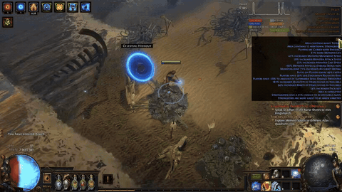
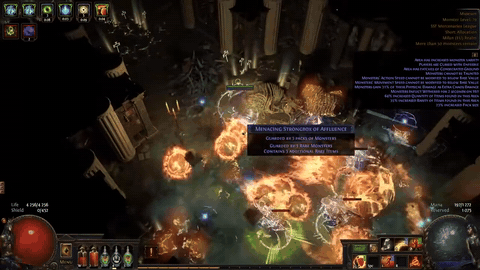
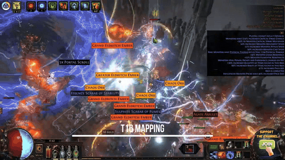
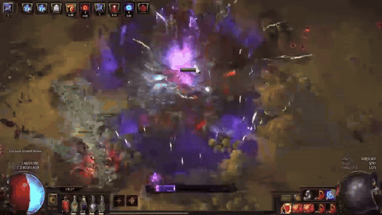
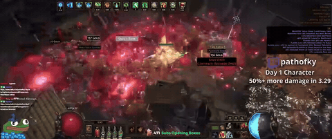
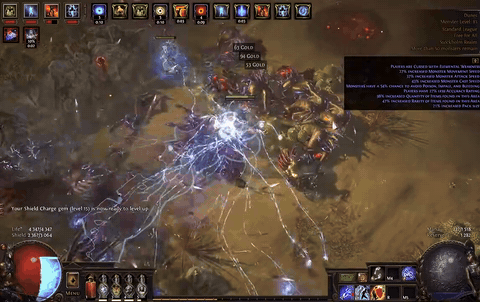
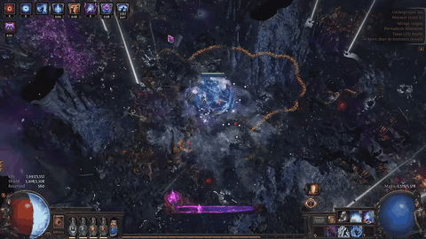

# Nick's 3.30 build shortlist

Updated 2026-11-13 (launch day), after the 3.30 patch notes. This page is the short version: the ranked picks, the fallback plans if Penance Brand doesn't feel good, the details of each pick, and the mid-budget swaps for later in the league. Everything behind it (Nick's rules, the change log, boss-damage and PoB checks, the community check, breakdown tables, prices, leads and open items) moved to **[shortlist-reference.md](shortlist-reference.md)** on Nov 13. Nothing was dropped.

**How to read the tables.** Ratings are Map / Boss / Defence / Pop, 1–5, estimated from guides, videos and PoB files, not measured. Rank = Boss + Defence + half the Pop score (a 3–4 counts as 3.5). Confidence says how well a pick is sourced. Prices are poe.watch averages from 3.29. Nick's rules and how the ratings work: [reference](shortlist-reference.md#nicks-rules-sources-and-ratings).

## Top picks

**If you want one answer on launch day, it is Penance Brand**, with its boss weapon planned from the start (see its row in [Pick details](#pick-details)). It ties Winter Orb on score, but it is better sourced, 3.30 left it alone, and both creator rankings made since the patch put it above Winter Orb. If it doesn't feel good once you play it, go to [Fallback plans](#fallback-plans).

| Rank | Pick | Map / Boss / Def / Pop | B + D + Pop/2 | Confidence | Pop source | Mapping ([all clips](mapping-clips.md)) |
|---|---|---|---|---|---|---|
| 1 | Penance Brand Ignite Elementalist | 4 / **3–4** / 4 / 4 (5 with Obliteration) | **9.5** (10 with Obliteration) | **High**: three creators' videos, two of them 3.30 guides; #2 on a post-patch top 10; 14th of 18 on Fubgun's starter list | One-cast ignite spread; Obliteration (3c) and Lost Unity (~9 div on day 14 of 3.29) explosions later |  |
| 1 | Winter Orb Occultist (start without power charges; Elementalist is the usual cheap start) | 5 / **3–4** (nerfed in 3.30) / 4 / **5** | **10** | **Low–medium**: nerfed in 3.30 and not measured since; Fubgun ranks it last of 18 starters | Herald of Ice shatter chains |  |
| 3 | Volatile Dead Spellslinger Elementalist | 5 / 3 / 4 / **5** | 9.5 | Low–medium: one guide, no player reports | Exploding seeker orbs from level 1; explode-on-kill gear later |  |
| 3 | Kinetic Bolt Elementalist | 4 / 4 / 4 / 3? | 9.5 | **Low**: one creator; the video does show pinnacle boss kills | Four heralds; how much it visibly pops is unconfirmed |  |
| 5 | Kinetic Blast of Clustering Necromancer | 4 / 3 / 4 / 4 | 9 | Medium–high: a 3.30 starter guide with day-one gameplay; 11th of 18 on Fubgun's list, the highest of these eight | Cluster explosions + Volatile Dead via Spellslinger |  |
| 6 | Bladefall + Blade Blast Assassin (Spellslinger → cast on crit) | 5 / 4 / 3 / 3 | 8.5 | **High**: three Ky videos, a timed practice run, player reports | Blade Blast detonations; Herald of Ash |  |
| 6 | Lightning Tendrils / Lightning Conduit Elementalist (also [fallbacks 1 and 2](#fallback-plans)) | 3 / 4 / 4 / 1 | 8.5 | **Medium–high**: two creator videos, a Reddit guide, five PoBs, a timed practice run | None |  |
| 8 | Spark of the Nova Archmage Hierophant | 4 / 3 / 4 / 1 | 7.5 | Medium: 16th of 18 on Fubgun's list | None |  |

The full confidence notes behind each row are in [Ranked table: full notes](shortlist-reference.md#ranked-table-full-notes), the reasoning in [Why this order](shortlist-reference.md#why-this-order), and which picks depend on a unique in [Uniques each pick leans on](shortlist-reference.md#uniques-each-pick-leans-on-nov-13).

## Fallback plans

Added Nov 13 at Nick's request: what to switch to **early** if Penance Brand doesn't feel good. The no-skill-swap rule is loosened for this section only, because he would probably go back later. Every option stays an Elementalist on the same Witch. Totems, mines, melee and janky mechanics are still out.

**Short version.** If bosses are the problem, go to Lightning Conduit (the cheapest switch) or Lightning Tendrils (the tankiest, with the best 3.30 guide). Crackling Lance is the lightning spell that plays from range. If the feel is the problem, Winter Orb has the pop and Volatile Dead Spellslinger is the trigger build.

**Try the free fixes first.** If the brand feels slow to go off, link Swiftbrand. If bosses feel slow, that is the build's known weak spot from the first maps to four Voidstones, and the fix is the boss weapon with Spellblade and Mark of Submission (see [Pick details](#pick-details)). Neither costs a respec.

| # | Switch to | Why it's on the list | Numbers | Respec from Penance Brand's mapping tree | Gear and gems | Catch |
|---|---|---|---|---|---|---|
| 1 | **Lightning Conduit** (Telvanni's wand + shield version; a Reddit guide has a staff version) | The cheapest switch. Rated Boss 4 / Def 4 | Telvanni, a day into 3.29 at level 89: 6.0M DPS, 104K EHP, 67% / 78% block, "zero deaths going through the campaign" | **About 53 refund points**: 33 passives, plus Shaper of Flames and Bringer of Ruin (4 ascendancy points). The Reddit staff route is about 59 and keeps Shaper of Flames | Rares plus Valako's Sign ("1 to 3 chaos on day 1"); the Reddit version also wears Mark of Submission, which the Penance Brand boss plan already has. Buy a spell wand and a spirit shield. Gems: Lightning Conduit, Orb of Storms, Elemental Focus, Lightning Penetration, Inspiration, Arcane Surge | Two buttons at close range: you and the monsters both have to stand in the Orb of Storms. It "plays a lot like a melee build", says the Reddit author. No pop |
| 2 | **Lightning Tendrils** ([Peuget2's 3.30 guide](https://www.youtube.com/watch?v=sOKiVtyhb8M)) | The most-watched Witch lightning starter for 3.30 and the tankiest fallback | Level 92 on two-Voidstone gear: 5.4M DPS, 259K EHP, 78% / 67% block, 25.8K physical max hit. Tuadh's practice run had Eater and Exarch dead at 5:33 | **About 78 refund points**: 58 passives plus the same 4 ascendancy points. Tuadh's simpler racing tree is about 61 | Rares plus Doedre's Damning, on a spell wand and a spirit shield. Gems: Lightning Tendrils, Added Lightning Damage, Inspiration, Increased Critical Damage, Infused Channelling | A stand-still channel: "you need to stand still". Not a fast clearer, and no pop. The Reddit author finds it "almost unplayable" before Heart of Destruction's area |
| 3 | **Crackling Lance** (Peuget2's 3.29 Elementalist starter) | The lightning spell you cast from range, so the closest of the three to Spark | Level 92: 4.6M DPS, 163K EHP, 78% / 68% block, 19.6K physical max hit, 7.8 casts a second. Tuadh's practice run: Eater and Exarch at 5:38 | **Not measured** (no PoB saved). Same author and the same wand + shield frame as the Tendrils build, so expect roughly the same, 70–80 points | Rares on a spell wand and a spirit shield; no unique named. Gems: Crackling Lance, Intensify, Spell Echo, Arcane Surge, Lightning Penetration, Inspiration | A 3.29 guide with no 3.30 update found, and only its build page was read, not the video. Damage ramps with Intensify while you stand and cast. No pop |
| 4 | **Winter Orb Elementalist** (not lightning; joint top pick) | For when the missing piece is pop and hit damage | About 5–6M on starter gear after the nerf, on paper (see [Pick details](#pick-details)) | **About 77 refund points**: 57 passives plus 4 ascendancy points (Fubgun's entering-maps tree) | Its own wand (Mystic Refractor is the usual starter), cold and mana-regen gear. Little carries over besides armour rares | Nerfed in 3.30 and untested since. A channel |
| 5 | **Volatile Dead Spellslinger** (not lightning; ranked 3rd) | For when the missing piece is a trigger build: one button, biggest pop | Boss 3; mid-game low-life set has 75% block and ~234K EHP (see [Pick details](#pick-details)) | **About 65 refund points**: 55 passives plus Bringer of Ruin (2 ascendancy points); keeps Shaper of Flames (Ky's Act 10 tree) | A wand to attack with (Frenzy), Desecrate and Volatile Dead on Spellslinger; Sandstorm Visage later | Bossing is its weak side, and bossing is the likeliest reason to leave Penance Brand |

**What a switch costs.** One refund point per passive and five per ascendancy point. The numbers above start from the "Maps" tree in Goratha's Penance Brand PoB (93 passives, three labs) and go to each guide's own early-maps tree, all read from the PoB files in [pob/](pob/). Every fallback is still an Elementalist, so only the ascendancy notables change, not the class. Refund points come from quest rewards and Orbs of Regret, one point each. The league-start sheet's own Act 7 respec (about 19 points) will have used the free ones, so count on buying these. Recent leagues also sell refunds for gold in the passive screen; the 3.30 price was not checked. **Switching during the campaign is cheaper**: from the levelling tree around level 50 it is about 30 points to Conduit or Volatile Dead, 40 to Winter Orb and 50 to Tendrils.

**Keeping a switch cheap, and going back.**

- **Level the fallback's gems early** in off-hand or spare sockets, so they are not level 1 on the day you switch. For a Witch, Lightning Tendrils and Orb of Storms are Act 1 quest rewards, and Lightning Conduit and Crackling Lance are both rewards from Sever the Right Hand in Act 3 (level 28). A quest gives only one of its rewards; Lilly Roth sells every gem from Act 6.
- **Keep the Penance Brand weapon, shield and gems in the stash.** Armour and resistance rares carry over both ways. The weapon and shield do not: the lightning builds are crit, so they want a spell wand and a spirit shield. The body armour's sockets need recolouring.
- **Going back costs about the same again**, 60 to 100 points depending on how far the fallback's tree has grown.

**Looked at and left out.**

- **Kinetic Bolt Elementalist** fits Nick best on paper (a wand attack, Boss 4 / Def 4, same ascendancy), but its only guide is a ~9 div, level-97 character with no early version. It is a mid-budget swap ([below](#mid-budget-picks-week-2-swaps-on-the-same-character-20-div)), not an early fallback.
- **Arc ignite Elementalist** was the most-watched Witch lightning build of 3.29 (ArminYou, 32.0k views; a BuffaloBaron series). It is ignite again, so DoT; its tanky version is CI with six unique items; and it uses Pact of Beidat, which 3.30 nerfed (4 additional beam chains at every gem level, was 4–6).
- **Herald of Thunder autobomber** is all pop, but it levels with Holy Flame Totem to 60 and its PoBs show 5.6K EHP at level 75 and 23K at level 98. It fails "hates dying".
- **Storm Brand Elementalist** is a brand, but no 3.30 guide was found. Zeeboub started 3.28 on it, was "tempted" again this league and chose Penance Brand.
- **Storm Burst of Repulsion** (Nick asked on Nov 13). The build known by that name is a Hierophant totem build, 9th on Fubgun's list, so it is a Templar and totems. A self-cast Elementalist version has one forum guide, updated for 3.29. It is another stand-still channel with a channel-and-release timing on top, and its own PoBs show 13–23K EHP at levels 87–91, against 104–259K for the three lightning fallbacks above. Details in [Leads](shortlist-reference.md#leads-and-honourable-mentions).
- **Hexblast ignite** is covered in [Leads](shortlist-reference.md#leads-and-honourable-mentions): free to try at level 28, not recommended as the plan.
- **Spark** has no Witch starter that I could find. The Spark pick is a Templar, so it needs a new character.

**Popular lightning starters this league** (Nick's question).

- **On a Witch:** Lightning Tendrils Elementalist (Peuget2's 3.30 guide, 57.8k views, the most-watched Witch lightning guide I found on poebuilds.cc's 3.30 list), Lightning Conduit Elementalist (the Reddit guide and Telvanni), Crackling Lance Elementalist (Peuget2; in the community's 3.30 build index) and Arc ignite Elementalist.
- **On other classes**, so a new character and not a fallback: Lightning Arrow Deadeye (a bow build and Fubgun's own start, 75.9k views; "Deadeye bows" are 7th of 18 on Fubgun's list), Static Strike (melee, 3rd), Storm Burst of Repulsion totems on Hierophant (9th), Archmage Hierophant with Spark, Crackling Lance or Arc (Templar, 16th; the Arc guide has 33.8k views), Arc of Oscillating on Assassin, and Storm Brand on Inquisitor or Hierophant.

Sources: poebuilds.cc's 3.30 and 3.29 build lists (view counts as of Nov 13), [Fubgun's 3.30 starter tier list](https://www.youtube.com/watch?v=mpj396DknOA), the community practice-run sheet, and the saved PoB files. Full notes on the Tendrils and Conduit guides are in [Pick details: full notes](shortlist-reference.md#pick-details-full-notes).

## Pick details

The same eight picks in rank order, short form. Every source, quote and number behind a row is in [Pick details: full notes](shortlist-reference.md#pick-details-full-notes).

| Rank | Pick | Online from | Key unique cost (3.29) | Why | Watch out for | Watch / read |
|---|---|---|---|---|---|---|
| 1 | **Penance Brand Ignite Elementalist** (animeprincess) · brand | Brand from the **first lab (~level 30)** on Goratha's route, which Nick's [league-start sheet](leveling/penance-brand-ignite-elementalist.html) ([text version](leveling/penance-brand-ignite-elementalist.md)) follows with Rolling Magma to 28. animeprincess's 3.30 guide waits for the third lab | ~1.3 div total on day 30: Aegis Aurora 131c, Cinderswallow Urn 50c, Nycta's Lantern 42c, Honourhome 2c. Lost Unity (~9 div on day 14) is an upgrade, not a requirement ([uniques check](shortlist-reference.md#uniques-each-pick-leans-on-nov-13)) | The tankiest brand build found on paper: 226K EHP and 75% / 78% block on the creator's first PoB (level 94), 354K once Lost Unity is on. One cast clears the screen through ignite spread, and the pop grows with Obliteration and Lost Unity. 3.30 left it alone. Most-played brand of 3.29 | Ignite is **DoT**. **Early bossing is the weak spot**, from the first maps to four Voidstones, and three of its creators say so. **Boss plan (animeprincess):** wear Mark of Submission with Flammability from the first maps; on bosses hold Nycta's Lantern or Rebuke of the Vaal and swap Swiftbrand for Spellblade, which has to be high level, so level that gem from the day you get it; keep Obliteration for maps. The brand takes about two seconds to go off before Lost Unity; Swiftbrand is the fix while mapping. If it still doesn't feel good: [Fallback plans](#fallback-plans) | [animeprincess 3.30 guide](https://www.youtube.com/watch?v=X3xQR9gM95E) · [Zeeboub 3.30 guide](https://www.youtube.com/watch?v=oygzdaPd1K8) · [Goratha 3.29](https://www.youtube.com/watch?v=42t9yK-9_Go) · [guide](https://mobalytics.gg/poe/builds/penance-brand-ignite-elementalist-league-starter) |
| 1 | **Winter Orb Occultist** (or start as Elementalist, same class) · spell | Level ~28 (levels with Freezing Pulse) | Nothing pricey to start (core pieces 6–183c). The power-charge version needs Ralakesh's Impatience: ~37–69 div in week 1 of 3.29, 1.7 div by day 14 ([cost and ascendancy](shortlist-reference.md#winter-orb-cost-and-ascendancy)) | #1 skill of 3.29. Herald of Ice chain explosions, the biggest pop here. CI and capped block, and the same skill to the uber endgame | **Nerfed in 3.30**: one projectile fewer and ~15% less base damage, about 30% less on a boss with the usual starter wand, and nobody has tested it since. Fubgun ranks it last of 18 starters: "30 to 40% weaker". It is a channel, and mana regen must cover its cost. Power charges are a week-2 upgrade, not a start | [ronarray in-depth starter](https://www.youtube.com/watch?v=yn1MzoinnUw) · [SoloHood day 1](https://www.youtube.com/watch?v=3oedKtr6Hls) · [SoloHood to 4 Voidstones](https://www.youtube.com/watch?v=zYLg8-yYkoY) |
| 3 | **Volatile Dead Spellslinger Elementalist** (Ky) · trigger | **Level 1**; crit swap mid-game. [League-start sheet](leveling/volatile-dead-spellslinger-elementalist.html) | Sandstorm Visage ~424c (2.4 div) | One button: Frenzy fires Desecrate + Volatile Dead, and the orbs seek enemies about two screens away and explode. Mid-game low-life version has 75% block and ~234K EHP | Semi-random targeting, so bossing is the weaker side. Trigger rate is touchy: attacking too fast cost Tuadh ~20% damage. One guide, no player reports | [Exarch & Eater league-start run](https://www.youtube.com/watch?v=VJyzmqdrETg) · [guide](https://mobalytics.gg/poe/builds/volatile-dead-spellslinger-elementalist-starter) |
| 3 | **Kinetic Bolt Elementalist** (K2Gaming) · wand | Kinetic Bolt from level 1, but there is no levelling guide | ~9 div total per the author: Thread of Hope + Lethal Pride, the rest rares | Best checked defence for the cost: 116K EHP, 64% / 65% block, 14M DPS (incl. Mirage Archer). The video shows Shaper, Maven, Searing Exarch and two Incarnation kills on that budget | One creator, a video with no commentary, and no levelling plan. The numbers are a level-97 character | [K2Gaming guide (3.29)](https://www.youtube.com/watch?v=TrkI-sZYshU) · [PoB](https://pobb.in/MFgKaLk7B568) |
| 5 | **Kinetic Blast of Clustering Necromancer** (Legi1 / maxroll route) · wand | Wand attacks from level 1: Kinetic Bolt → **Kinetic Blast at 28** → Clustering ~70 | None to start. Whispers of Infinity fixes single target later: 10 div on day one of 3.29, ~2 div three days later | The wand build with the most coverage. Late game is tanky: CI, ~9k ES, 75% block, ~236K EHP. Fubgun's 3.30 list has it 11th of 18, the highest of these eight. A 3.30 starter guide clears a four-Voidstone T16 on day-one gear | Low single target before Whispers of Infinity: "do not play this build if you don't want to deal with low single target" (Redviles). Skip the Kinetic Fusillade step in Legi1's route, and buy the Clustering gem on trade | [lifewithoutpants 3.30 starter](https://www.youtube.com/watch?v=lTYVlFrYlgQ) · [Redviles 3.29 league-start guide](https://www.youtube.com/watch?v=QOXeHiSK-9U) · [guide (jungroan)](https://mobalytics.gg/poe/builds/jungroan-kinetic-blast-of-clustering-necromancer) |
| 6 | **Bladefall + Blade Blast Assassin: Spellslinger → cast on crit** (Ky) · trigger | Spellslinger at **level 37** (levels with Blight / Essence Drain). **Cast on crit at ~level 85** for about 3 div. [League-start sheet](leveling/bladefall-blade-blast-spellslinger-assassin.html) | None required | Nick's old favourite and a true zero-to-hero trigger arc, one button the whole way. Ky had all four Voidstones on day 2 with under 5 div of gear | The cast-on-crit step lands at ~level 85, the kind of late switch Nick dislikes. Fragile until ~level 90: Tuadh's level-77 practice character has 10K EHP. One player hated the cast-on-crit step: "dying every map due to coc clunkiness". 3.30 costs the Spellslinger phase a little (the free Assassin's Mark now needs an attack crit) | [Slinger league-start guide 3.29](https://www.youtube.com/watch?v=d3fCmCBM0F0) · [day-2 update](https://www.youtube.com/watch?v=G9eXPIaWmO8) · [Tuadh's 3.30 practice run](https://www.youtube.com/watch?v=gtIl0ZyxkII) |
| 6 | **Lightning Tendrils / Lightning Conduit Elementalist** (Peuget2; a Reddit guide; Telvanni) · spell | Tendrils from the second lab (~55) after levelling with Power Siphon (Peuget2), or Conduit from the first lab (Telvanni) | Cheap: rares plus Doedre's Damning (Tendrils) or Valako's Sign (Conduit) | A lightning crit spell that bosses early and ends up tanky: 259K EHP and 5.4M DPS at level 92 on two-Voidstone gear. The fastest timed practice run of the picks (5:33). Same ascendancy as Penance Brand, so these are fallbacks 1 and 2 [above](#fallback-plans) | The play style: Tendrils is a stand-still channel and Conduit a close-range two-button spell. No brand, no wand attack at endgame, no pop | [Peuget2's 3.30 starter](https://www.youtube.com/watch?v=sOKiVtyhb8M) · [Telvanni's Conduit, day 1 (3.29)](https://www.youtube.com/watch?v=OJ8P64fg4D0) · [Reddit guide](https://www.reddit.com/r/PathOfExileBuilds/comments/1xta6na/) |
| 8 | **Spark of the Nova Archmage Hierophant** (Big Ducks) · spell | Same skill throughout | Under ~1.5 div (Widowhail ~5c, Kitava's Thirst 26c, Militant Faith ~212c?) | Closest to "old Spark". 75% block / 75% spell block, no aiming, a "very tanky map blaster" | Great in corridors, weak in open maps and big boss arenas. Fubgun's 3.30 list has Archmage Hierophant 16th of 18: "can feel a bit clunky day one nowadays". A Templar, so there is no swapping to or from the Witch picks | [Spark Archmage is BACK (3.29)](https://www.youtube.com/watch?v=DpHXNVNeH88) |

## Mid-budget picks: week 2 swaps on the same character (~20 div)

Added 2026-11-10. Nick's rule: zero-to-hero comes first, but if he gets bored he wants to **swap builds without rolling a new character**. A same-class respec is fine (Elementalist → Occultist); a new class is not. He'll have currency by then, so a swap target does not need to work as a starter. Budget: about 20 div.

**How a swap works.** Go back to the Labyrinth, refund the ascendancy points (five refund points each, so 40 for all eight) and pick the new ascendancy at the altar ([poedb](https://poedb.tw/us/Ascendancies)). The base class can never change. The passive tree respec is on top of that.

**Timing matters more than budget.** Swap uniques fell fast in the second and third week of 3.29, so waiting pays: the first five rows below cost about 62 div together on day 10 and about 10 div on day 20.

| Item | Day 10 (Aug 3) | Day 14 (Aug 7) | Day 20 (Aug 13) |
|---|---|---|---|
| Ralakesh's Impatience (power charges) | 1,893c | 288c | under 114c |
| Foulborn Berek's Respite (explode shocked) | 4,611c | 1,940c | 252c |
| Kalandra's Touch | 2,311c | 1,956c | 849c |
| Oriath's End | 1,383c | 986c | 293c |
| Polaric Devastation | 935c | 718c | 192c |
| Sandstorm Visage | 449c | 708c | 383c |
| Foulborn Romira's Banquet (+1 power charge) | 1,210c | 1,061c | 695c |
| Lost Unity | 1,564c | 1,612c | 1,230c |

Prices below are poe.watch daily means for **day 14 of 3.29** (Divine ≈ 172c) unless a day is given. A few items show the same 217c on that day (Whispers of Infinity, Militant Faith, Lethal Pride), which looks like a placeholder, so those use the day-10 or day-20 value.

### Witch (Winter Orb, Penance Brand, Volatile Dead, Kinetic Bolt and KBoC all start here)

| # | Swap to | Fits Nick as | Shopping list | What ~20 div gets you | Catch | Confidence |
|---|---|---|---|---|---|---|
| 1 | **Winter Orb power-charge Occultist** (ronarray, Fubgun) | Spell, Herald of Ice pop (5) | Ralakesh's power 288c, Tulfall 253c, Graven's Secret 86c, Willclash 38c, Malachai's Loop 5c: **~3.9 div**. Foulborn Romira's Banquet 1,061c (6.2 div). About 10 div of uniques; the rest goes on ES gear and cluster jewels | A player farmed T16 temples "on 15d as an occultist with 8 power charges" and reached level 95 solo. Players' bar for swapping: "10 power charges and 6k ES". ronarray's level-97 endgame PoB is this set plus Badge of the Brotherhood and a second Foulborn Romira's Banquet (about 17 div of uniques at these prices): 7,244 ES, 74% / 78% block, 240K EHP and 12.9M boss DPS in 3.29, which works out to about 5–8M after the nerf ([boss damage](shortlist-reference.md#boss-damage-winter-orb-vs-penance-brand-ignite)) | Under-geared it disappoints: "I swapped to Occultist on 100d budget and it feels terrible" (skimped on clusters). Boots were still 11 div on day 10. **3.30 made it weaker:** the skill does ~43% less to a single boss on this set (Tulfall adds no projectiles), the boots now take away one power charge and Malachai's Loop gives one fewer, with nothing given back to Occultist. One player's counter: power charges were "only nerfed if you used the Ralakesh Malachai cookie cutter setup" (unverified). Fubgun's own 3.30 patch review: "50 to 60% less damage compared to last patch" at endgame, "probably really not a build worth playing anymore" | Low–medium (was Medium–high before the patch notes) |
| 2 | **Kinetic Blast of Clustering Necromancer** (Redviles, jungroan) | Wand attack, Volatile Dead through Spellslinger (pop 4) | Whispers of Infinity (30c on day 10; Redviles: ~2 div three days into 3.28), Crown of the Inward Eye 66c, Shavronne's Revelation 70c, Anathema 49c. Uniques under 3 div; the budget goes on ES gear | Redviles: after "10 to 20 divines" it has "pretty similar clear" and "relatively similar single target" to the meta builds and "a lot more defenses". At 20–30 div: CI, 8k+ ES, ~20k armour, capped block | Single target stays behind Winter Orb. Many sockets to fill | Medium |
| 3 | **Kinetic Bolt Elementalist** (K2Gaming) | Wand attack, four heralds (pop 3?) | Author's total is ~9 div. Lethal Pride 23–46c, Thread of Hope from ~22c, the rest rares | 116K EHP, 64% / 65% block, 14M DPS; the video shows Shaper, Maven, Exarch and two Incarnation kills | One creator, no commentary. No ascendancy change from any Elementalist start | Low |
| 4 | **Penance Brand ignite, pop version** | Brand, explosions (pop 5) | Obliteration 3c, Aegis Aurora 140c, Mark of Submission 1c, **Lost Unity 1,612c (9.4 div)** | animeprincess: the budget setup "handles all standard endgame content". Goratha on Lost Unity: "shield charge through the map and everything else blows up". PoB with Lost Unity: 3.3M DPS and 354K EHP (2.2M and 226K without it); the next damage step is Grace of the Goddess, not priced ([boss damage](shortlist-reference.md#boss-damage-winter-orb-vs-penance-brand-ignite)) | Ignite is DoT. Obliteration is for maps; swap weapon for bosses. Herald stacking beyond Lost Unity may cost more in 3.30, because scarabs were removed and Kingsmarch shipping rewards changed (see [Tier list and 3.30 guides](shortlist-reference.md#tier-list-and-330-guides-nov-13)) | Medium–high |
| 5 | **Volatile Dead Spellslinger, crit version** (Ky) | Trigger, biggest pop (5) | Sandstorm Visage 708c + Polaric Devastation 718c: **8.3 div** on day 14, 3.3 div by day 20. Pop pieces: Oriath's End 986c, Foulborn Berek's Respite 1,940c (both under 300c by day 20) | Guide's mid-game low-life set: 75% block, ~234K EHP | Bossing is its weak side (Boss 3). One guide, no player reports | Low–medium |
| 6 | Cast-on-crit Forbidden Rite Occultist (Xeverous) | Trigger, the proven uber-killer (5 / 5 / 5) | ~20 div entry at 3.28 prices: Whispers of Infinity, Aegis Aurora 140c, Crown of the Inward Eye 66c, Militant Faith ~10c | Its guide video shows 5, 50 and 500 div versions; the build's reputation is uber farming | **Triggers from Cyclone**, a melee attack. Ky no longer recommends it. Only if Nick can live with spinning | Medium |
| 7 | **Lightning Tendrils or Lightning Conduit Elementalist** (Peuget2; shawnkfox's Reddit guide) | Lightning crit spell; no pop (1) | Valako's Sign and Mark of Submission ("1 to 3 chaos on day 1"), Agnerod West (not priced), Replica Dragonfang's Flight with the skill's own roll (15c for the generic listing; "could be fairly cheap or very expensive"). Peuget2's wand + shield version needs no build uniques | Reddit guide's level-96 set, "a few div each by the 2nd weekend": 46–51M DPS, 155–208K EHP, 75% / 75% block, "easily capable of doing 40/40, farming ubers". Peuget2's two-Voidstone set: 5.4M DPS, 259K EHP | Tendrils is a stand-still channel; Conduit takes two buttons at close range. From Penance Brand's mapping tree the respec was measured on Nov 13 at about 53–59 refund points for Conduit and 61–78 for Tendrils (see [Fallback plans](#fallback-plans)); the staff version also replaces the weapon and shield. Same ascendancy class as any Elementalist start, though two or four ascendancy points move | Medium–high |
| ✗ | Inpulsa "ThunderBOMB" Herald of Thunder Elementalist | Biggest pop | Kalandra's Touch 1,956c (11.4 div), The Annihilating Light 37c unlinked (far more six-linked), Inpulsa's Broken Heart ~230c six-linked | 68M DPS in its 3.28 guide | Physical max hit 11k, so it fails "hates dying". Over budget before day 20 | — |

### Shadow (Bladefall + Blade Blast Assassin starts here)

| # | Swap to | Fits Nick as | Shopping list | What ~20 div gets you | Catch | Confidence |
|---|---|---|---|---|---|---|
| 1 | **Cast on crit Bladefall + Blade Blast** (Ky), the planned next step | Trigger | ~3 div to switch (cluster jewel, essence foil, 14% cooldown recovery). Ming's Heart 14c, Cloak of Defiance 48c unlinked, Skin of the Lords 435c six-linked (the Mind over Matter one is rare) | Ky: a fifth of his endgame budget "and you are just good to do all Ubers"; his set includes a Headhunter and a ~20 div ring, so that fifth is more than 20 div. Players rate it highly at ~30 div | One player found it clunky and fragile after the switch: "dying every map due to coc clunkiness" (see the Bladefall row in [Pick details](#pick-details)). 3.30's Assassin's Mark fix doesn't touch this step: it only casts on attack crits anyway | Medium–high |
| 2 | **Power Siphon Assassin** (AFANA, 3.29) | Nick's favourite wand attack | Ralakesh's power 288c and Shavronne's Revelation 70c for the CI switch ("after level 85... at least 3,500 Energy Shield"), Lethal Pride 23–46c | Guide says its PoB carries to four Voidstones and has an endgame set; uber test video exists | No DPS, EHP or budget numbers anywhere in the guide. "Not tanky at first". Uses the Oshabi bloodline. Its levelling PoB is a Trickster ([our plan](leveling/power-siphon-trickster.md)), also a Shadow. 3.30: the power-charge boots now cost one power charge; Trickster's defences were buffed (Heartstopper, One Step Ahead, Spellbreaker) | Low |
| 3 | Detonate Dead autobomber, bow cast on crit | Trigger (Detonate Dead inside a trigger is fine), corpse pop | Replica Maloney's Mechanism 34c | Unknown: 3.28 forum guide, no numbers read | Bow, not wand. Needs capped crit | Low |
| 4 | Winter Orb Assassin | Spell, Herald of Ice | Same Winter Orb pieces as Witch #1 | One player posted that swapping from Bladefall to Winter Orb on an Assassin "was great" | Other players: "it's going to feel worse on Assassin than Elementalist and Occultist" and "Assassin always has defense problem". Commenters on the post asked for proof. Winter Orb was nerfed in 3.30, and Deathmarked's free Assassin's Mark now needs an attack crit, which a pure spell build doesn't have | Low |

Also Shadow, not costed: Penance Brand of Dissipation Assassin (an uber video exists, budget unknown) and Spark Nova Brand Saboteur (~300c, but its author says single target "can lack"). A 3.30 wand starter on the same class, Kinetic Bolt of Fragmentation Assassin, was read on Nov 11 and rated 6: too fragile to rank (see [Leads](shortlist-reference.md#leads-and-honourable-mentions)).

### Templar (Spark of the Nova Archmage Hierophant starts here)

| # | Swap to | Fits Nick as | Shopping list | What ~20 div gets you | Catch | Confidence |
|---|---|---|---|---|---|---|
| 1 | **Power Siphon cast-on-crit Archmage Firestorm** (Kross) | Wand attack + trigger + Inpulsa's pop (4) | Same ascendancy and most of the same mana tree as Spark Archmage. Uniques ~1.5 div; Kross says under 10 div for a starter version | Unknown at 20 div. His ~60 div character has 46.7K EHP and ~19M real DPS (see [what the PoB shows](shortlist-reference.md#power-siphon-cast-on-crit-what-the-pob-shows)) | Not tanky; one creator. 3.30 left its gems, uniques and ascendancy alone | Low |
| 2 | Kinetic Blast of Clustering Hierophant (Palsteron, Scorpius) | Wand attack | Not priced. Its players start on another skill and swap after about 10 div | CI, 80% / 80% block, 98K EHP | Physical max hit only 8k | Low–medium |
| 3 | Inquisitor respec: Ball Lightning + Vaal Storm Call, Penance Brand of Dissipation, or Firestorm cast on crit | Lightning spell / brand / trigger | Not priced: none has a guide with a gear list | Ball Lightning: 17.8M DPS and 132K EHP on a hardcore SSF character | No guides; budgets unknown | Low |
| ✗ | Crit Spark mana stacker (animeprincess) | Spark | ~30 div by its guide | — | Over budget | — |

### What this means for the pick

- **Witch still gives the most swaps**, but 3.30 weakened the best-evidenced one. Power-charge Winter Orb costs about 10 div of uniques by day 14 and now does less: nerfed skill, two fewer power charges. The swaps 3.30 did not touch are the wand builds (KBoC Necromancer, Kinetic Bolt Elementalist), the Penance Brand explosion setup and crit Volatile Dead.
- **Penance Brand Ignite Elementalist is the top pick, jointly with Winter Orb since Nov 12**, and its own week-2 step (#4, Obliteration and Lost Unity) is the cheapest upgrade here that 3.30 left alone.
- **Shadow** has the cast-on-crit step built in and one swap Nick would love on paper (Power Siphon Assassin), but that guide has no numbers.
- **Templar** has the fewest proven options.
- **Wait for day 14–20.** The swap uniques that cost 10–25 div on day 10 were 1–2 div ten days later. Treat 3.29 prices as a guide only: 3.30 changed loot (rare and unique monsters no longer drop 80% less currency, and monster rarity now steers which uniques drop), and Winter Orb demand should be lower after the nerf.

Sources: poe.watch item histories; Redviles, Ky, animeprincess and Goratha transcripts ([../videos/README.md](../videos/README.md)); [AFANA's forum guide](https://www.pathofexile.com/forum/view-thread/3459073); Reddit threads [1v9f7ry](https://www.reddit.com/r/PathOfExileBuilds/comments/1v9f7ry/) and [1v926vm](https://www.reddit.com/r/PathOfExileBuilds/comments/1v926vm/) (comments only; the post itself couldn't be read).

## More in the reference doc

Moved to [shortlist-reference.md](shortlist-reference.md) on Nov 13, unchanged:

- [Nick's rules, sources and ratings](shortlist-reference.md#nicks-rules-sources-and-ratings) and the [change log](shortlist-reference.md#change-log)
- [Why this order](shortlist-reference.md#why-this-order) and the [full notes behind the ranked table](shortlist-reference.md#ranked-table-full-notes)
- [Pick details: full notes](shortlist-reference.md#pick-details-full-notes), with every source, quote and video
- [Uniques each pick leans on](shortlist-reference.md#uniques-each-pick-leans-on-nov-13) (the Lost Unity question)
- [Leads and honourable mentions](shortlist-reference.md#leads-and-honourable-mentions): Hexblast ignite, Archmage Crackling Lance Hierophant, Reliquarian ideas, Power Siphon builds
- [Winter Orb: cost and ascendancy](shortlist-reference.md#winter-orb-cost-and-ascendancy) and [Boss damage: Winter Orb vs Penance Brand ignite](shortlist-reference.md#boss-damage-winter-orb-vs-penance-brand-ignite)
- [Power Siphon cast on crit: what the PoB shows](shortlist-reference.md#power-siphon-cast-on-crit-what-the-pob-shows)
- [Community check (Reddit)](shortlist-reference.md#community-check-reddit): how well each pick is backed, the 3.30 tier lists and guides, timed practice runs
- [Breakdown by category](shortlist-reference.md#breakdown-by-category): every build looked at, by type
- [Key unique prices](shortlist-reference.md#key-unique-prices-one-month-into-329), [Notes](shortlist-reference.md#notes) and [Pending](shortlist-reference.md#pending)
